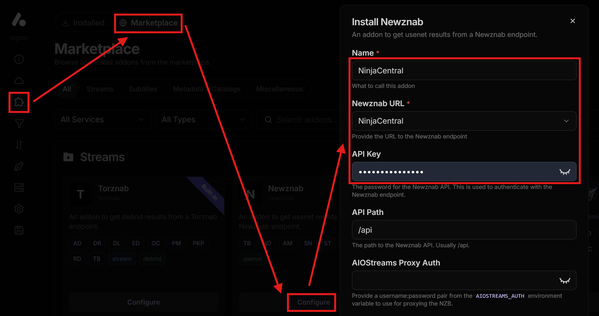
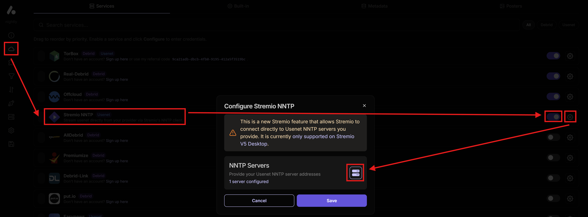

# 🗄️ Usenet

Usenet is a whole thing by itself, and definitely much more complex to understand and setup. It's beyond the scope of this guide for beginners, at least for the time being, because a proper Usenet setup requires a lot of components, but especially since the latest v5 release of Stremio supports **NNTP** playback natively (albeit still limited), I thought I would include this section to introduce the concept and provide you with two of the simplest approaches to get a basic setup going. It's totally optional of course, and not worth scratching your head about it if you're happy with the perfect setup from this guide :), but it might be worth giving it a try especially if you're having difficulties finding obscure, unpopular, or old content, and/or content in your specific language. It's worth mentioning that it is a more costly endeavour usually than using torrents or Debrid, so you can stop reading if you don't/can't spend any more money on this.

Let's start with a short explanation of what Usenet is:

**Usenet** is a server-to-server distribution network where content is posted to "newsgroups" and then replicated across many provider backbones, so it ends up behaving like a huge distributed archive. When someone uploads a movie or show (or music, ebooks, etc.), it is split into many small segments (often thousands). Those segments are posted as individual articles, copied and distributed between servers, and kept for a certain time based on each provider’s retention. When you download, you are not pulling from other users like torrents. You are fetching those segments directly from your provider’s servers, then reassembling them into the original file.

In practice, most setups have three moving parts:

* **Usenet Provider**: The (paid) access layer that gives you a login to Usenet servers and lets you download the segments through the NNTP protocol. Retention and completion vary by provider/backbone. *Equivalent to a Debrid service as your paid service provider, but it downloads from Usenet servers, not a torrent swarm.* There are many provider brands available to choose from, but most of them aggregate into around 10 different backbones globally. Usually all content is distributed throughout all of Usenet, meaning also among these backbones, but of course it's not a universal rule (just like with torrents and seeders). Some of the most popular providers are:
   * [**EasyNews**](https://www.easynews.com/) one of the most famous ones.
   * [**NewsHosting**](https://www.newshosting.com/) also very popular, in the same backbone as EasyNews.
   * [**Eweka**](https://www.eweka.nl/) is mainly popular in Europe.
   * [**TorBox**](https://torbox.app/subscription?referral=f7feee59-8c0d-4842-b53a-07738c37f7f1) has a **Pro** plan that includes Usenet access, but it's not a traditional Usenet provider, as you will read further down.
   * ***👉 Quick Tip**: Watch out for **Black Friday** deals, that's when you can get the best deals.*

* **NZB Indexer**: The search layer that finds releases and generates an NZB file. The NZB is a small “manifest” (like a map) that points to the exact message IDs and groups needed to fetch all segments. *Equivalent to the Stremio scraper addons or a torrent indexer.* There are a lot of indexers available that have varying content focuses. Some are free with limits, but most are paid, either subscription-based, or some also offer lifetime packages. I can't provide an exhaustive list here and I don't even know all of them myself, but for those who are interested in getting the best long-term deals like me, here are some of the indexers with the best price-performance ratio:
   * ***👉 Quick Tip**: I've included some of the best indexers according to my research, but also only those that have historically provided lifetime options at least at some point, so that if you decide to pay for any of these, you can really get the best value. That said, these deals are usually not active all the time, but just like with the providers, mainly during **Black Friday**, so don't complain to me for not finding any deals, just wait for the next BF and hope they have some good deals.*
   * [**NinjaCentral**](https://ninjacentral.co.za/) doesn't allow open registration regularly, but usually opens it during BF, and last time lifetime was around 60€.
   * [**NZBgeek**](https://www.nzbgeek.info/) also had its last lifetime BF deal at around $60.
   * [**altHUB**](https://althub.co.za/) had its last lifetime BF deals for around $20, so wait around for the next deal.
   * [**Usenet Crawler**](https://www.usenet-crawler.com/) is currently for some time offering a lifetime promo for the "donation" price of $20.
   * [**NzbNest**](https://www.nzbnest.com/) is a newcomer but a strong contender, offering a lifetime option too at the price of around 25€ as of the latest BF deal if you pay by crypto.
   * **Honorary Mentions**:
      * [**DrunkenSlug**](https://drunkenslug.com/) is very popular, but it's invite-only, and has a limited free tier. You can monitor [**r/UsenetInvites**](https://www.reddit.com/r/UsenetInvites/) for people offering invites if you want one.
      * [**SceneNZBs**](https://scenenzbs.com/) is for the German-speaking users out there, being one of the most popular for German content. Costs around 15€ per year, and 10€ from the third year onward.

* **Downloader**: Takes the NZB, downloads all segments over NNTP, verifies them, and if some are missing it can often repair the gaps using PAR2 recovery blocks, then it rebuilds the final file. *Equivalent to a torrent client (which Stremio does natively), but with server downloads and built-in repair features.*

* **[OPTIONAL] Automation Tools**: The *\*arr* suite (**Sonarr** for TV, **Radarr** for Movies, **Lidarr** for Music, **Readarr** for Books, etc.) is the automation layer that monitors what you want, searches for releases, sends NZBs to your downloader, then imports and organizes the finished files. **NZBHydra2** or **Prowlarr** often sits in front of multiple NZB indexers as a single unified search endpoint, so you manage indexers once and let the *\*arr* apps query that instead of configuring each indexer everywhere. Together with a downloader like **SABnzbd** or **NZBGet**, they turn Usenet from a manual “find and download” workflow into an automated pipeline. Finally, tools like **NZBDav** or **AltMount** can sit on top of your downloader and expose completed or in-progress downloads as a streamable library, so Stremio can play them like a regular source. All of these tools however need self-hosting, which makes the entire setup more complicated, and thus out of scope for this guide.

In Stremio, Usenet is useful because it can give you fast, consistent playback that does not depend on torrent swarm health or peer availability. With the newer *native NNTP support*, Stremio can take an **NZB** (the "map" of all the file parts) and fetch those parts directly from your Usenet provider over NNTP, then stream the video as it assembles. You still need an **NZB Indexer** to find the release and generate the NZB, and you still need a **Usenet Provider** for the actual server access, but the big change is that Stremio can handle them directly just like it does with torrents, so it no longer has to rely on separate "bridge" tools to turn a Usenet download into something it can play.

Getting to the point, you can choose to do a proper Usenet setup and automate it to your liking, but for that you'll need to do some research yourself, because there is currently no all-in-one guide I can recommend you, and there are many options to even make that possible. However, you can do the basic approach if you're interested, which goes as follows:
1. Get an *API Key* from one or more indexers by creating an account and buying a subscription (or lifetime during promos).
2. In **AIOStreams**, go to **Addons**, then **Marketplace**, find the **Newznab** addon, and press configure.
3. You can change the name from *Newznab* to the name of the indexer to easily differentiate them later if you have more than one indexer. *Newznab is a standardized API (interface) that NZB indexers expose so apps can search them, filter results, and pull NZB links in a consistent way. Pretty much all indexers usually provide this access point.*
4. In **Newznab URL** you can select the indexer of your choice. The ones mentioned here are all available, but you can also add a *Custom* indexer if not on the list.
5. In **API Key** you need to paste the key from the indexer.
6. Check any other settings if you need to do some modifications, and click on **Install**.
7. You can repeat these steps for all indexers if you bought more than one (which is why you renamed Newznab to the indexer name earlier), just install additional **Newznab** addons.
8. Don't forget to save the **AIOStreams** configuration by pressing "**Save**" on the "**Save & Install**" tab.

What you just did is configure the indexers, meaning you are able to search for streams on Usenet. However, you still haven't configured the provider. For that, there are two approaches on how you can set it up:

* **TorBox**: The first one is by getting a *TorBox Pro* plan, which includes Usenet access, and doesn't even need the Stremio native NNTP feature. The way this works is similar to the caching approach for Debrid. This means, after you have configured **Newznab** with the indexers you want to use, and considering the **TorBox** addon is already installed from the *AIOStreams* template of this guide if you are using TorBox as a Debrid service, then the following happens:
   1. You search for a show on Stremio.
   2. If there are any streams available for that show on the indexer, they are shown on the streams list marked as "**[TB] Indexer · USENET**", which can show with a ⚡ icon, meaning it's already cached and you can open it directly, or most probably with a ⏳ icon as uncached.
   3. When you open an uncached Usenet stream, TorBox starts to download the file on their own servers for you. This should normally take a few seconds, but it's much faster than opening a torrent which depends on seeds, because it is downloaded from other servers.
   4. The stream should open normally in a bit. If it doesn't or gives an error, just wait a few seconds or minutes, and try opening it again.
   * *The normal Usenet approach, if you do the proper setup with the self-hosted tools and especially **NZBdav** or **AltMount**, would allow you to stream directly from the Usenet provider and not have to wait even a few seconds or minutes. But as mentioned, TorBox is not a traditional Usenet provider and doesn't currently provide NNTP access to allow that, but has to download the files on their servers first. It's a tradeoff, but also avoids having to self-host the tools.*

* **Stremio NNTP**: As mentioned in the beginning, Stremio v5 started supporting NNTP natively, just like torrents, which means Stremio is able to stream directly from Usenet providers. This avoids the need to self-host tools like **NZBdav** or **AltMount** which act as intermediaries, and use NZB files directly to connect to the Usenet providers. This is a great addition, it has however its limitations in the current form. It's only supported in the Windows app and the Android TV app version of Stremio at the moment, and it doesn't currently implement any health checks or any additional features that the usual more complex Usenet setup supports. It does work great however in its simple approach, and it should become available soon in all platforms, as announced by the Stremio developers. To configure this, it's only a few steps:
   1. In **AIOStreams**, go to the **Services** tab, find **Stremio NNTP**, enable the toggle, and click the gear icon to configure it.
   2. Press the server button to the right of the "*NNTP Servers*" section.
   3. Enter the NNTP information which you can get from your Usenet provider you selected earlier (except TorBox).
   4. Click "**Save**" on both tabs, and save the **AIOStreams** configuration on the "**Save & Install**" tab.
   5. Now when you open a show, if there are any streams available for that show on the indexer, they are shown on the streams list marked as "**[SN] Indexer · USENET**", which should show with a ⚡ icon. You can open them directly and they should normally start playing in just a few seconds.

* **WARNING**: When using an indexer, there are two communication steps happening: first the indexer is queried (**Search step**) for what you're trying to watch, and then when you select it from the streams list, the NZB file is downloaded from the indexer (**Grab step**) so that the downloader can use it to retrieve the file parts. With the basic Usenet setup described here, the search step is performed by the *AIOStreams* instance, and the grab step by either *TorBox* or *your local Stremio installation* depending on the approach chosen earlier. This causes the indexer to be contacted from two different IPs for each step, and there are indexers that do not allow that. This may consequently cause your indexer account to get flagged or banned. **SceneNZBs** for example explicitly disallows streaming usage with Stremio. **NinjaCentral** supposedly allows it as long as you're not sharing the account with others, but I can't confirm this. You'll need to check online or with the indexer whether they allow different IPs (if you contact them, don't mention that you want to stream on Stremio specifically, because that would probably get you banned). There are ways to configure it to use the same IP, but this cannot be done from a public AIOStreams instance and would require self-hosting it, which is as mentioned in th beginning, beyond the scope of this guide.

That's it! As mentioned, these are two of the simplest approaches to getting started with the Usenet ecosystem, but it might help you increase your chances on finding difficult to find content, and maybe to introduce you to the extensive world of Usenet.
